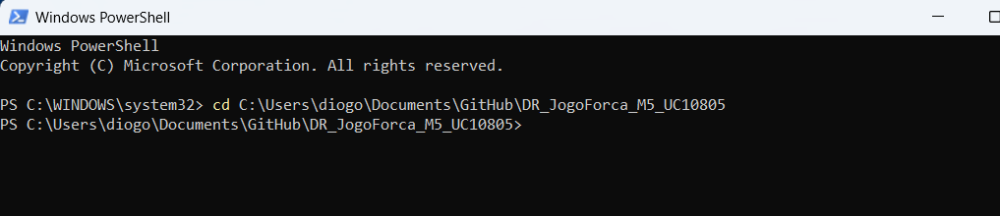
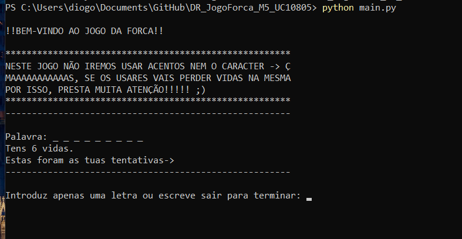
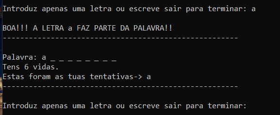
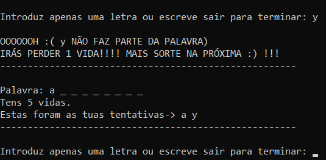
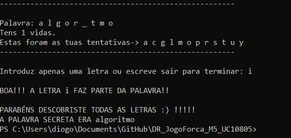
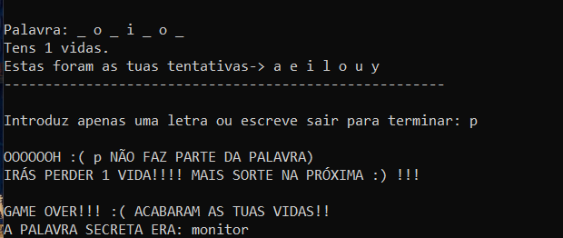

# 🕹️APRESENTAÇÃO DO PROJETO: JOGO DA FORCA🕹️
---

## 1.   ☣️ Definição do Problema 

- O objetivo do projeto consistiu em desenvolver um jogo interativo em Python que recriasse o clássico **Jogo da Forca** em ambiente de consola/terminal\
- O programa irá sortear uma palavra secreta e o utilizador terá a tarefa de adivinhar essa palavra, letra a letra, dentro de um limite máximo de **6 vidas**, que representam: 1- cabeça, 1- tronco, 2- braços e 2- pernas

---
## 2.   ⚙️ Decisões Técnicas
De forma a tentar garantir um código alinhado com as boas práticas da **PEP 8**, foram tomadas as seguintes decisões:

*   **Separação de responsabilidades:**
    *   `main.py`: Ponto de entrada do programa que controla o ciclo principal do jogo e captura interrupções forçadas do sistema
    *   `jogo.py`: Contém toda a mecânica do jogo, tais como: validação de inputs, contagem de vidas, revelação da palavra escondida/secreta.
    *   `palavras.py`: Contém a lista de palavras possíveis de serem palavra secreta, é responsável apenas pelo armazenamento das palavras que vão ser selecionadas aleatóriamente

*   **Validação de Inputs e Regras:**
    * Caracteres especiais genéricos e números serão rejeitados pelo sistema sem qualquer penalização, sendo dada mais uma oportunidade ao utilizador.
    * Tentativas com acento ou o uso de "ç"/"Ç" serão inputs aceitas, mas irão contar como falha, havendo penalização com perda de 1 vida. Utilizador é avisado sobre esta regra em cada inicio de cada jogo.
    * O sistema converte automaticamente os palpites para minúsculas para comparar com as letras pertencentes à palavra secreta.
    * O utilizador poderá encerrar/desistir do jogo a qualquer momento, bastando digitar "sair".

*   **Tratamento de Exceções:**
    * Foi implementado uma captura de interrupções como `KeyboardInterrupt` e o `EOFError`, de forma a garantir que o programa irá encerrar de forma "limpa"

## 3.   🖥️ Demonstração do Jogo (Exemplo para Windows)

A execução do jogo ocorre diretamente no terminal através dos seguintes comandos:

```bash
# Ir até à pasta raiz
cd caminho/para/a/pasta/raiz

# Execução do programa
python main.py

``` 
### Exemplos nas imagens abaixo:

#### **Exemplo cd + caminho onde se encontra a "pasta raiz":**


#### **Exemplo da execução do programa depois de estar na "pasta raiz":**



### Fluxo visual no Terminal:

- **Início:** Mensagem de boas-vindas com aviso sobre caractere "ç" e letras com acentos e é apresentada a palavra secreta sob a forma de traços. Por exemplo uma palavra com 5 letras `_ _ _ _ _`
- **Ciclo de jogo:** O utilizador insere uma letra -> o sistema valida o input -> Atualiza a palavra substiuindo os traços pela letra adivinhada ou subtrai 1 vida em caso de ser uma tentativa falhada.
- **Fim do Jogo:**
    * **Vitória:** Revelada a palavra antes de acabarem as vidas
    * **Derrota:** Jogo é encerrado, revelando a palavra que o utilizador falhou em adivinhar.

### Alguns exemplos do comportamento do programa no terminal:

#### **Exemplo da mensagem inicial:**


#### **Exemplo de um input certeiro:**


#### **Exemplo de um input falhado:**


#### **Exemplo de uma vitória:**


#### **Exemplo de uma derrota:**


---

## 4.   🧱 Dificuldades Encontradas
*   **Tratamento de inputs:** Ajustar a lógica para distinguir caracteres verdadeiramente inválidos e colmatar várias possibilidades erradas que o utilizador poderia introduzir no sistema.
*   **Atualização da Palavra:** Fazer a atualização dos traços para as letras desvendadas de forma eficaz com código pouco extenso.

---

## 5.   🔮 Melhorias Futuras
Caso haja uma evolução deste projeto no futuro, as principais melhorias a ser pensadas poderiam ser:

- **Interface Gráfica:** Implementar uma interface visual com botões para cada letra e uma ilustração gráfica de um boneco e a forca.
- **Níveis:** Possibilitar ao utilizador escolher entre vários níveis diferentes de dificuldade, onde a dificuldade poderia variar consoante o tema, o tamanho e/ou o idioma.
- **Histórico:** Possibilitar com que um utilizador tenha acesso aos ultimos jogos.

