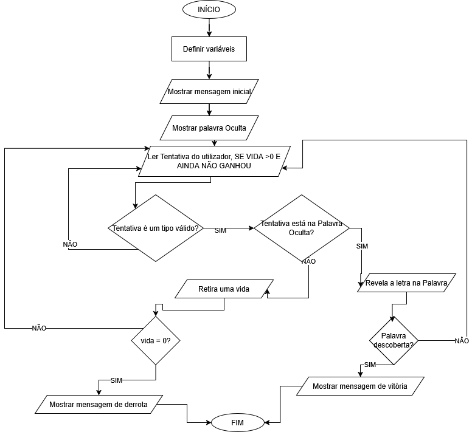

# Projeto: Jogo da Forca

## 📝 Definição do Problema 
Criar um programa/jogo em Python onde o utilizador seja capaz de descobrir uma palavra com palpites únicos e sucessivos de letras dentro de um limite de tentativas.

## 🎯 Objetivo do Jogo
Permitir que o utilizador descubra uma palavra secreta, adivinhando letra a letra de forma individual e consecutiva antes de se acabarem as suas vidas/tentativas a que tem direito.

## 📑 Regras Principais
**1.** A Palavra secreta é apresentada escondida sob a forma de traços, por exemplo, para uma palavra com 5 letras: ( **_ _ _ _ _** )\
**2.** Através do teclado o utilizador irá introduzir uma letra de cada vez\
**3.** Se a letra indicada pelo utilizador existir o programa irá revelar os espaços correspondentes que contenham essa letra.\
**4.** Se a letra indicada pelo utilizador **não** existir na palavra secreta, este irá perder 1 vida/tentativa

## 🎖️ Condições de Vitória e Derrota
- **Vitória->** Todas as letras da palavra secreta são descobertas antes do utilizador esgotar as suas vidas
- **Derrota->** O utilizador perde as suas vidas antes de descobrir todas as letras da palavra secreta

## 🛠️ Limitações e Restrições Técnicas
- **Número de Vidas:** Máximo de 6 vidas(como o típico jogo da forca: 1x cabeça, 1x tronco, 2x braços e 2x pernas)
- **Tipo de Input:** Apenas caracteres alfabéticos irão ser considerados válidos independentemente de serem maiúsculos ou minúsculos.
- **Ambiente:** Código será realizado em Python e executado em modo consola/terminal

---
---

## 📝 Requisitos para o Jogo da Forca

### **Requisitos Funcionais:**
**1.** O sistema deve permitir selecionar uma palavra secreta de forma aleatória a partir de uma lista definida previamente.\
**2.** O sistema deve apresentar a palavra secreta no ecrã sob a forma de traços(Underscore), sendo que cada traço corresponde à letra que falta adivinhar.\
**3.** O sistema deve solicitar ao utilizador a introdução de **um** caractere alfabético de cada vez através do teclado\
**4.** O sistema deverá validar o input introduzido pelo utilizador garantindo que apenas são aceites caracteres alfabéticos válidos, sejam as letras maiúsculas ou minúsculas\
**5.** Em cada tentativa o sistema deverá atualizar o estado da palavra desvendando as letras descobertas/acertadas\
**6.** O sistema deverá gerir o contador de vidas, decrementando uma vida em caso de falha.

### **Requisitos Não Funcionais:**
**1.** O jogo deverá ser executado inteiramente na consola/terminal, com mensagens intuitivas e será totalmente em português.\
**2.** O código-fonte deverá ser escrito seguindo as boas práticas da **PEP 8**.\
**3.** O Programa deverá ter implementado blocos de exceção para evitar que vá abaixo caso o utilizador introduza algum dado inválido ou caso ocorra um erro inesperado.

---
---
## 📈 Fluxograma do Jogo da Forca

---
---
## 🛖 Estrutura do Projeto
- **main.py:** Ponto de entrada do Programa
- **jogo.py:** Lógica principal e a mecânica do jogo
- **palavras.py:** Módulo de dados com a lista de palavras secretas.